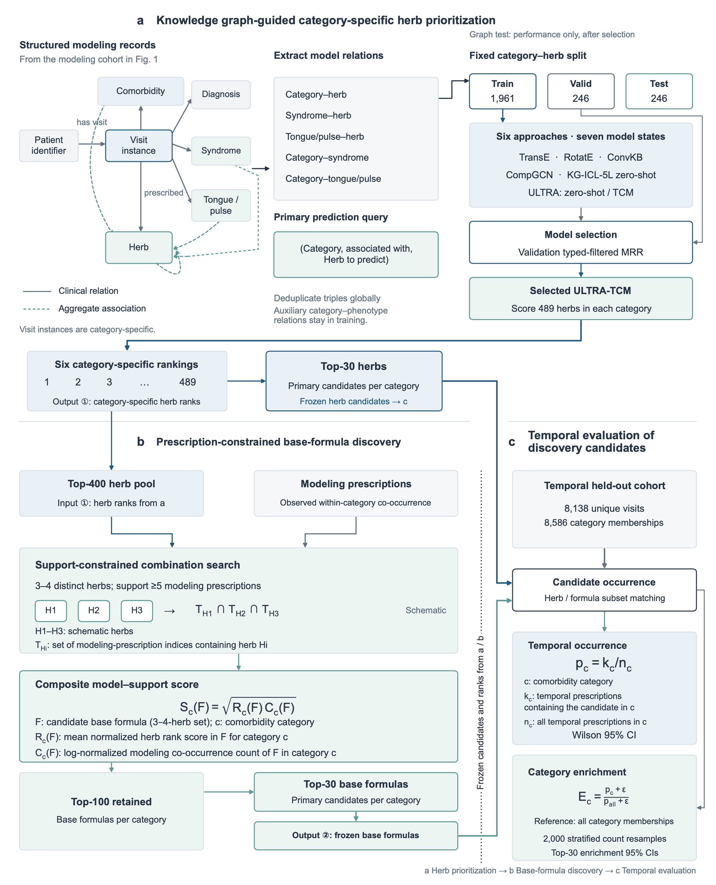

# KG-H2F

**A Chinese herbal medicine knowledge graph and candidate base formula discovery for sleep-related comorbidities.**

KG-H2F organizes associations among diseases, traditional Chinese medicine (TCM) syndromes, and herbs from clinical records. It combines knowledge graph relation prediction with prescription co-occurrence information to identify candidate herbs and base formulas for different sleep-related comorbidity categories, then evaluates their occurrence rates and category enrichment in prescriptions from a later period.

## Method Overview

[](figure/main_figure.pdf)

The workflow consists of four stages:

1. **Knowledge organization**: Convert standardized clinical records into an encounter-centered knowledge graph linking diagnoses, TCM syndromes, tongue and pulse findings, and herbs.
2. **Relation prediction**: Compare TransE, RotatE, ConvKB, CompGCN, KG-ICL, and ULTRA to obtain herb scores for each comorbidity category.
3. **Base formula discovery**: Combine herb scores with prescription co-occurrence during the modeling period to search for and rank candidate herb combinations.
4. **Temporal validation**: Calculate occurrence rates, enrichment, and confidence intervals for candidate herbs and base formulas using prescriptions from a later period.

Candidate discovery uses only prescriptions from the modeling period. Prescriptions from the later period are used for subsequent evaluation and do not contribute to candidate selection or ranking updates.

## Installation

Python 3.10 or later is recommended. Run the following commands from the repository root:

```bash
python -m venv .venv
source .venv/bin/activate
python -m pip install -r requirements.txt
```

In Windows PowerShell, activate the environment with `.venv\Scripts\Activate.ps1`.

To use the third-party model source code, also install the model dependencies:

```bash
python -m pip install -r requirements-training.txt
```

See the [third-party model documentation](external/README.md) for instructions on obtaining and placing pretrained weights.

## Usage

The repository currently provides code for candidate herb evaluation, base formula discovery, strategy comparison, and related analyses. The examples below start from existing category–herb scores; the repository does not yet include entry points for the complete graph construction and model training workflow.

### 1. Prepare Data and Scores

Place standardized prescription records under `data/broad_category_splits_standardized_6/<category>/`, saving records from the modeling period as `train.json` and those from the later validation period as `test.json`. See the [data documentation](data/README.md) for category identifiers and required fields.

Place herb scores for each category in `outputs/result_v1/selected_scores/`. Name each file `comorbidity_<category>_selected_herb_scores.csv` and include at least the `herb_name` and `score` columns.

Raw clinical data, model weights, and experimental results are not distributed with the repository and must be prepared before running the code.

### 2. Evaluate Candidate Herbs

```bash
python category.py \
  --score-dir outputs/result_v1/selected_scores \
  --output outputs/result_v1/temporal_validation/candidate_herbs.csv \
  --bootstrap-times 2000 --bootstrap-top-k 30
```

The output includes herb rankings, occurrence rates in the later validation period, Wilson confidence intervals, and bootstrap confidence intervals for category enrichment.

### 3. Discover Candidate Base Formulas

```bash
python basic_discover.py \
  --score-dir outputs/result_v1/selected_scores \
  --output outputs/result_v1/temporal_validation/candidate_base_formulas.csv \
  --candidate-top-k 400 --min-size 3 --max-size 4 --min-count 5 \
  --retain-top-k 100 --validation-top-k 30 --bootstrap-times 2000
```

This example searches for combinations of 3–4 herbs among the top 400 candidate herbs, requires each combination to occur at least 5 times during the modeling period, retains the top 100 candidates per category, and computes temporal validation metrics for the top 30 candidates.

For additional options, run `python category.py --help` and `python basic_discover.py --help`. The entry point for comparing herb pool selection strategies is `scripts/compare_formula_discovery_strategies.py`.

## Repository Structure

| Path | Description |
| --- | --- |
| `category.py` | Candidate herb ranking and temporal validation |
| `basic_discover.py` | Candidate base formula search, scoring, and evaluation |
| `calculate_prediction_auc.py` | AUROC / AUPRC calculation from relation prediction scores |
| `scripts/` | Cohort analysis, encounter identifier checks, and base formula strategy comparison |
| `external/` | Third-party source code and adaptations for ULTRA and KG-ICL |
| `figure/` | Method overview figure and original PDF |
| `data/` | Local input directory and data format documentation |
| `outputs/` | Model scores and analysis results |
| `docs/` | Study workflow and code organization documentation |

## Acknowledgments

This project uses the open-source implementations of [ULTRA](https://github.com/DeepGraphLearning/ULTRA) and [KG-ICL](https://github.com/nju-websoft/KG-ICL). See [external/README.md](external/README.md) for third-party licensing and adaptation details. The respective licenses are retained in the corresponding directories.
